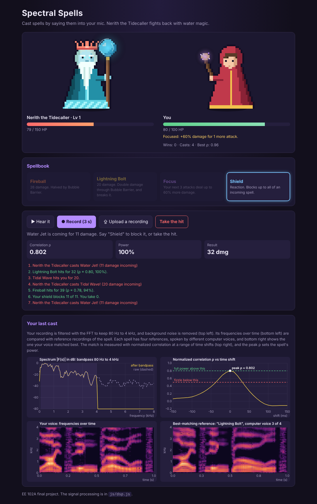
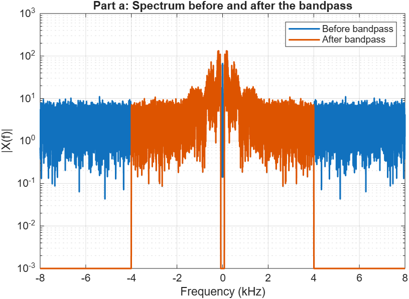
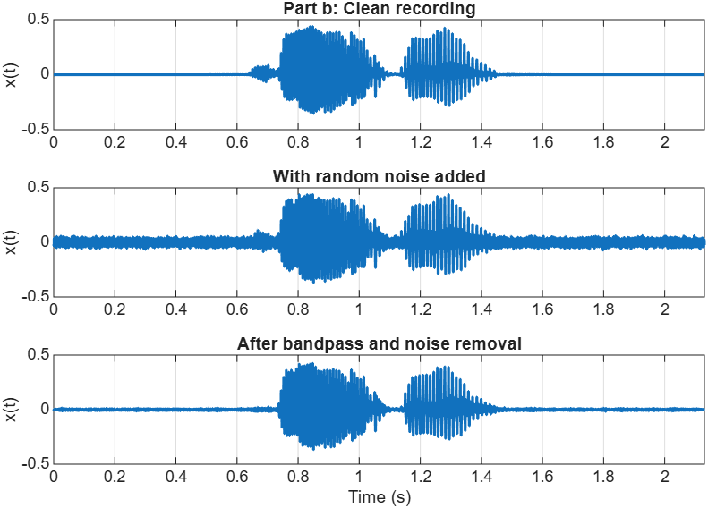
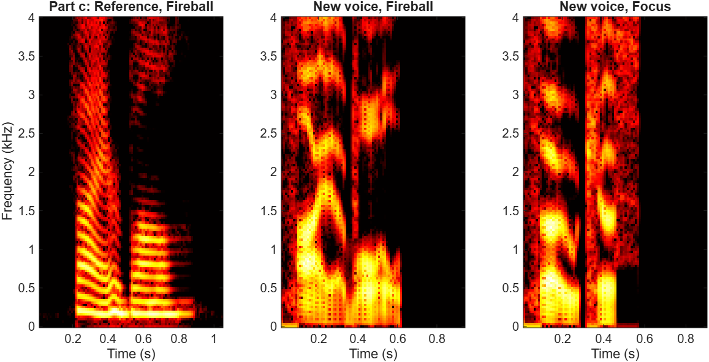
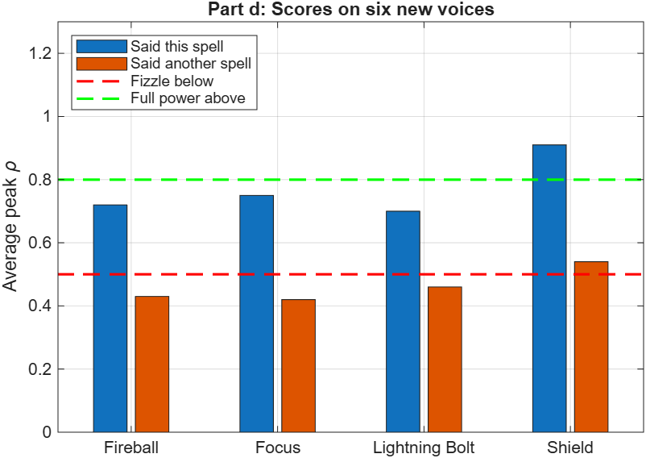
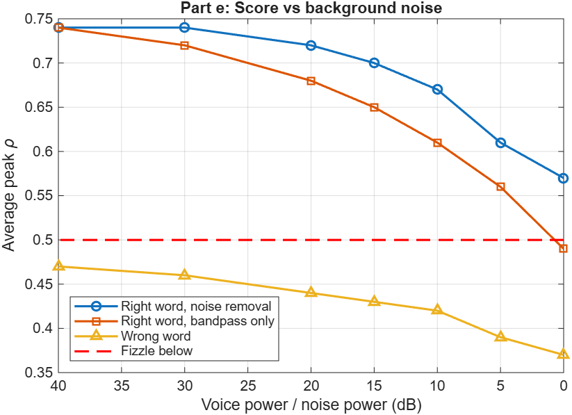

# Spectral Spells

My EE 102A final project. You fight a water mage by saying spells into your microphone. The game filters your recording, compares it with reference recordings of the spell, and uses the match to decide how strong the spell is.

**Play:** `https://willbaosu.github.io/spectral-spells/`



## The game

| Spell | When | What it does |
|:--|:--|:--|
| Fireball | Your turn | 26 damage. Halved while Bubble Barrier is up. |
| Lightning Bolt | Your turn | 20 damage. Double damage against Bubble Barrier, and it breaks the barrier. |
| Focus | Your turn | Your next 3 attacks deal up to 60% more damage. |
| Shield | Reaction | Blocks up to all of an incoming spell. |

On your turn, pick a spell, press **Hear it** to hear the incantation, then press **Record** and say it. You can also upload an audio file. Nerith the Tidecaller then casts Water Jet (11 damage), Tidal Wave (20 damage), Healing Rain (heals 18), or Bubble Barrier. When an attack is coming, you can say "Shield" to block it or take the hit.

Every spell's power comes from the correlation ρ between your recording and the reference recordings. Below ρ = 0.5 the spell fizzles. At ρ = 0.8 or higher it is at full power. In between, power rises linearly.

## How the scoring works

All of the signal processing is in [`js/dsp.js`](js/dsp.js).

1. **Bandpass filter.** The game takes the fft of the recording, multiplies by H(s) = rect(s/2f_high) − rect(s/2f_low) with f_low = 80 Hz and f_high = 4 kHz, and takes the inverse fft. H depends only on |s|, so the +nΔf and −nΔf points are kept together and the result stays real. This removes hum below the voice and hiss above it.

   

   *Part a. The spectrum |X(f)| of a noisy recording of "Fireball," shown with fftshift. Outside ±4 kHz there is only noise, and the bandpass removes it on both the positive and negative sides. The thin gap at 0 is the ±80 Hz cut.*

2. **Resampling.** The browser records at 48 kHz. The game converts to 16 kHz with linear interpolation. The bandpass already removed everything above 4 kHz, so 1/Δt = 16 kHz ≥ 2 · 4 kHz and nothing aliases.
3. **Noise removal.** The signal is cut into short pieces and each piece is fft'd. The quietest 10% of pieces are taken as background noise, which gives a noise level at each frequency. Each piece is scaled down at frequencies where the noise is as strong as the voice, then inverse fft'd.

   

   *Part b. The same recording clean, with random noise added (voice power = 10 × noise power), and after the bandpass and noise removal.*

4. **Finding the word.** The game keeps the loudest stretch of speech and drops silence, coughs, or a repeated word.
5. **Frequencies over time.** The game takes an fft of every 32 ms piece, every 10 ms (N = 512, so Δf = 1/(NΔt) = 31.25 Hz). Each fft is summed into 24 frequency bands. Then the log band energies of each piece get an inner product with cosines, like Fourier series coefficients. The low coefficients describe which sound is being made. Pitch and loudness are left out, so different voices saying the same word look alike.

   

   *Part c. Short ffts of three recordings: time left to right, frequency bottom to top, brighter is stronger. The horizontal stripes in the reference are the harmonics f, 2f, 3f, ... of the voice. The new voice saying "Fireball" has the same overall shape as the reference. Saying "Focus" does not.*

6. **Correlation.** Your result C is compared with each reference R using normalized correlation, ρ = Σ R·C / √(ΣR² · ΣC²). The game slides your recording up to ±150 ms and stretches it between 80% and 125% to allow for timing. It keeps the highest ρ across the four reference voices of the spell.

## Test results

The references are four text-to-speech voices per spell. The scoring was tested on 24 other recordings: six different text-to-speech voices, each saying all four spells. None of these voices is used as a reference.

**Can it tell the right word from a wrong one?** Average peak ρ:

| Spell | Said this spell | Lowest | Said a different spell |
|:--|:--|:--|:--|
| Fireball | 0.72 | 0.65 | 0.43 |
| Focus | 0.75 | 0.67 | 0.42 |
| Lightning Bolt | 0.70 | 0.53 | 0.46 |
| Shield | 0.91 | 0.81 | 0.54 |

In 23 of the 24 recordings, the spell that was said scored highest. The one miss was a high-pitched voice saying "Focus," which scored 0.68 on Shield and 0.67 on Focus. This cannot happen in a fight, since Focus is only cast on your turn and Shield only as a reaction. Wrong words usually fizzle. Shield is the most forgiving: a different word averages 0.54, which would still block about 13% of a hit.



*Part d. The numbers from the table above. Blue bars should be above the red line and orange bars below it.*

**Does it work with background noise?** Random noise was added to the test recordings. The table shows the average peak ρ for the right word.

| Voice power / noise power | 40 dB | 20 dB | 10 dB | 5 dB | 0 dB |
|:--|:--|:--|:--|:--|:--|
| With noise removal | 0.74 | 0.72 | 0.67 | 0.61 | 0.57 |
| Bandpass only | 0.74 | 0.68 | 0.61 | 0.56 | 0.49 |

At 0 dB the noise is as strong as the voice. With noise removal, the right word still stays above the fizzle line.



*Part e. The same results as a plot, with the wrong-word score added.*

**Limitation.** All of the test voices are text-to-speech. Real voices may score lower. If casting feels too hard, lower `RHO_FAIL` and `RHO_FULL` at the bottom of `js/dsp.js`.

The figures were made with [`report_figures.m`](report_figures.m) in MATLAB. To rerun the tests: `node tests/run_tests.js`. It also checks that the FFT matches the DFT computed directly and that the bandpass keeps a 1 kHz tone while removing 30 Hz and 6 kHz tones.

## Running it

The page loads its recordings with `fetch`, so it has to be served from a web server. Opening `index.html` directly will not work.

**GitHub Pages:** Settings → Pages → Deploy from a branch → `main`, `/ (root)` → Save. Browsers only allow the microphone on HTTPS pages, which GitHub Pages provides.

**On your computer:** run `python3 -m http.server 8000` in this folder and open `http://localhost:8000`.

## Files

```
index.html               game page
css/style.css            layout and colors
js/dsp.js                signal processing
js/game.js               spells, combat, recording
js/sprites.js            pixel-art sprites
js/fx.js                 spell animations
js/charts.js             plots of your last cast
report_figures.m         MATLAB script for the README figures
spells/<spell>/*.wav     reference recordings, four voices per spell
enemy/*.wav              Nerith's spell lines
tests/run_tests.js       tests
tests/audio/*.wav        test recordings
docs/                    screenshot and figures
```

## Credits

The recordings were made with the Flite and eSpeak NG text-to-speech programs.
