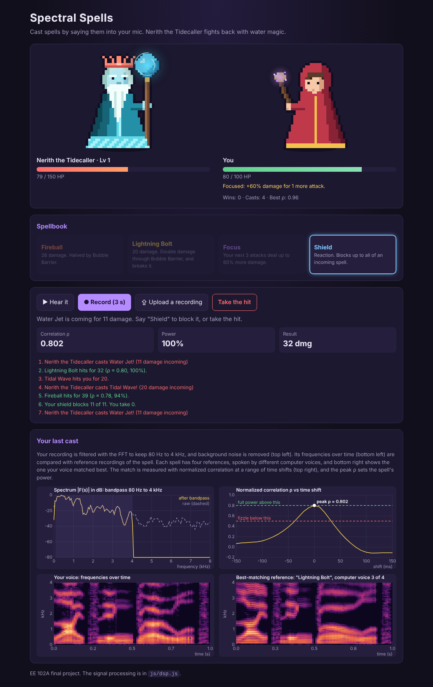
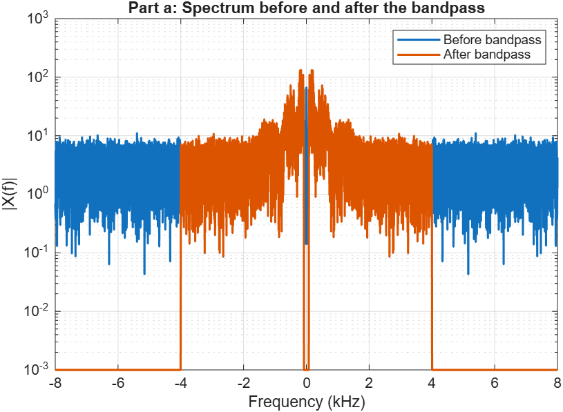
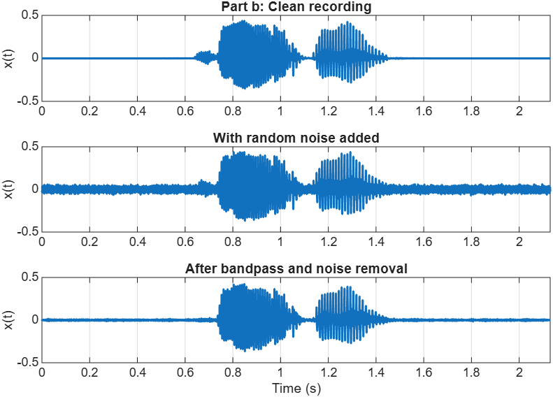
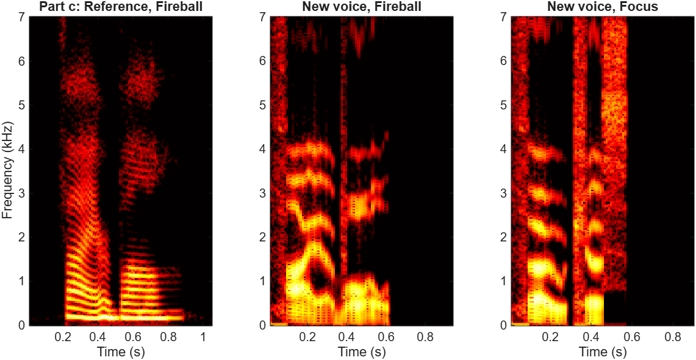
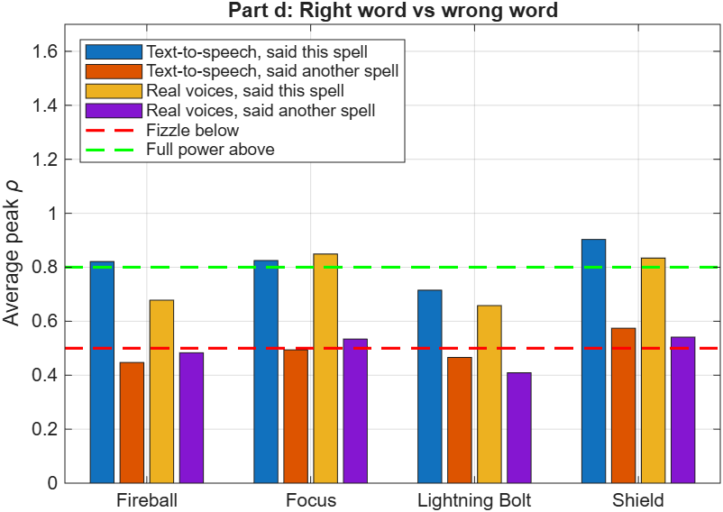
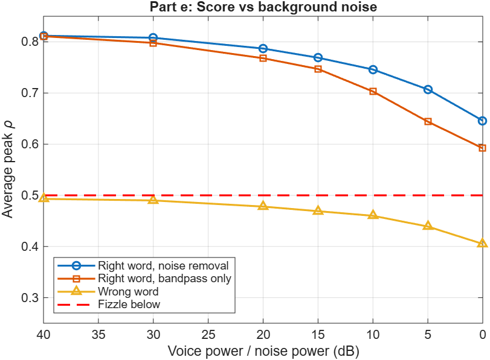
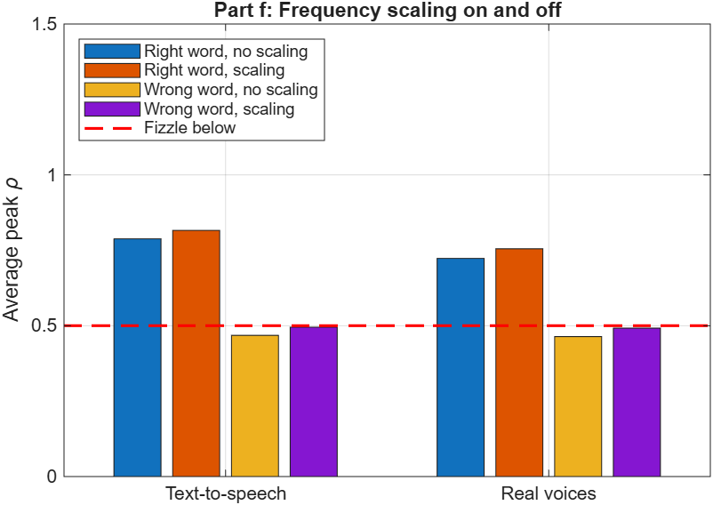

# Spectral Spells

My EE 102A final project. You fight a water mage by saying spells into your microphone. The game filters your recording, compares it with reference recordings of the spell, and uses the match to decide how strong the spell is.

**Play:** `https://willbaosu.github.io/spectral-spells/`



## The game

Every spell has a power from 0% to 100%, set by how closely your voice matches the incantation. The power is based on the correlation ρ between your recording and the reference recordings:

| ρ | Power |
|:--|:--|
| below 0.5 | 0% (the spell fizzles) |
| 0.5 to 0.8 | rises in a straight line from 0% to 100% |
| 0.8 or higher | 100% |

Each spell's effect is scaled by its power.

| Spell | When | At 100% power |
|:--|:--|:--|
| Fireball | Your turn | 26 damage. Halved while Bubble Barrier is up. |
| Lightning Bolt | Your turn | 20 damage. Doubled against Bubble Barrier, and it breaks the barrier. |
| Focus | Your turn | Your next 3 attacks deal 60% more damage. |
| Shield | When Nerith attacks | Blocks all of the incoming damage. |

For example, a Fireball said at 50% power does 13 damage, and a Shield at 50% power blocks half of the attack.

**Voice training.** Each time you open the game, it asks you to record each spell. One take per spell is enough to start, and up to three are kept. Each take is added as an extra reference for that spell, so the game compares your voice with your own voice as well as with the reference recordings. Takes last for the session. The **Voice training** button lets you add or replace takes during the fight.

When Nerith's HP reaches 0, he melts into a puddle. You can then play again or fight a stronger Nerith.

On your turn, pick a spell, press **Hear it** to hear the incantation, then press **Record** and say it. You can also upload an audio file. Nerith the Tidecaller then casts Water Jet (11 damage), Tidal Wave (20 damage), Healing Rain (heals 18), or Bubble Barrier. When an attack is coming, you can say "Shield" to block it or take the hit.

## How the scoring works

All of the signal processing is in [`js/dsp.js`](js/dsp.js).

1. **Bandpass filter.** The game takes the fft of the recording, multiplies by H(s) = rect(s/2f_high) − rect(s/2f_low) with f_low = 80 Hz and f_high = 7 kHz, and takes the inverse fft. H depends only on |s|, so the +nΔf and −nΔf points are kept together and the result stays real. This removes hum below the voice and hiss above it. The top edge is 7 kHz because hissing sounds like the f and s in "Focus" or the sh in "Shield" are mostly between 4 and 7 kHz. With the edge at 4 kHz, Focus scored noticeably lower.

   

   *Part a. The spectrum |X(f)| of a noisy recording of "Fireball," shown with fftshift. Outside ±7 kHz there is only noise, and the bandpass removes it on both the positive and negative sides. The thin gap at 0 is the ±80 Hz cut.*

2. **Resampling.** The browser records at 48 kHz. The game converts to 16 kHz with linear interpolation. The bandpass already removed everything above 7 kHz, so 1/Δt = 16 kHz ≥ 2 · 7 kHz and nothing aliases.
3. **Noise removal.** The signal is cut into short pieces and each piece is fft'd. The quietest 10% of pieces are taken as background noise, which gives a noise level at each frequency. Each piece is scaled down at frequencies where the noise is as strong as the voice, then inverse fft'd.

   

   *Part b. The same recording clean, with random noise added (voice power = 10 × noise power), and after the bandpass and noise removal.*

4. **Finding the word.** The game keeps the loudest stretch of speech and drops silence, coughs, or a repeated word.
5. **Frequencies over time.** The game takes an fft of every 32 ms piece, every 10 ms (N = 512, so Δf = 1/(NΔt) = 31.25 Hz). Each fft is summed into 24 frequency bands. Then the log band energies of each piece get an inner product with cosines, like Fourier series coefficients. The low coefficients describe which sound is being made. Pitch and loudness are left out, so different voices saying the same word look alike.

   

   *Part c. Short ffts of three recordings: time left to right, frequency bottom to top, brighter is stronger. The horizontal stripes in the reference are the harmonics f, 2f, 3f, ... of the voice. The new voice saying "Fireball" has the same overall shape as the reference. Saying "Focus" does not.*

6. **Frequency scaling.** A higher voice moves its whole spectrum up, which is close to a frequency scaling F(s/a). The bands are spaced by a fixed ratio, so scaling by a moves the band energies by a fixed number of bands. The game tries a = 0.85, 0.925, 1, 1.075, and 1.15.
7. **Correlation.** Your result C is compared with each reference R using normalized correlation, ρ = Σ R·C / √(ΣR² · ΣC²). The game slides your recording up to ±150 ms and stretches it between 80% and 125% to allow for timing. It keeps the highest ρ across all frequency scalings and all references of the spell, including your training takes.

## Test results

**How it was tested.** Each spell currently has four reference recordings, made with text-to-speech voices. The game compares your voice against these. To check that it also works on voices it has never heard, two sets of test recordings were scored against every spell:

- **Text-to-speech:** six other text-to-speech voices, each saying all four spells (24 recordings).
- **Real voices:** two people, each saying all four spells once (8 recordings). More speakers and takes will be added.

**Does saying the right spell score higher than saying the wrong one?** Each number is a peak ρ.

| Spell selected | Text-to-speech, right word (average) | Text-to-speech, right word (worst voice) | Text-to-speech, wrong word (average) | Real, right word (average) | Real, wrong word (average) |
|:--|:--|:--|:--|:--|:--|
| Fireball | 0.82 | 0.76 | 0.45 | 0.68 | 0.48 |
| Focus | 0.83 | 0.74 | 0.49 | 0.85 | 0.53 |
| Lightning Bolt | 0.72 | 0.60 | 0.47 | 0.66 | 0.41 |
| Shield | 0.90 | 0.83 | 0.57 | 0.83 | 0.54 |

For example, the Fireball row means: when the six text-to-speech test voices said "Fireball," their recordings averaged ρ = 0.82 against the Fireball references, and the lowest was 0.76. When they said one of the other three spells, the score against Fireball averaged 0.45, which fizzles.

For every spell, the right word scores above 0.5 for both sets. Wrong words average close to 0.5. They are highest for Shield, and for Focus with real voices, so a wrong word there can still cast a weak spell. Lightning Bolt has the lowest right-word scores.

The test also checked which spell each recording matched best. That was the spell actually said in 23 of 24 text-to-speech recordings and 7 of 8 real ones. Both misses were "Lightning Bolt" scoring slightly higher on Shield.



*Part d. The averages from the table above. Bars for the right word should be above the red line, and bars for the wrong word below it.*

**Does it work with background noise?** Each text-to-speech test recording got 0.5 s of silence on each side, then random noise. The table shows the average peak ρ for the right word.

| Voice power / noise power | 40 dB | 20 dB | 10 dB | 5 dB | 0 dB |
|:--|:--|:--|:--|:--|:--|
| With noise removal | 0.81 | 0.79 | 0.75 | 0.71 | 0.65 |
| Bandpass only | 0.81 | 0.77 | 0.70 | 0.64 | 0.59 |

At 0 dB the noise is as strong as the voice. Noise removal keeps the right word well above the fizzle line, and it helps more as the noise gets louder.



*Part e. The same results as a plot, with the wrong-word score added.*

**Frequency scaling.** The same recordings, scored with and without frequency scaling. Each number is the average peak ρ.

| | Right word, without | Right word, with | Wrong word, without | Wrong word, with |
|:--|:--|:--|:--|:--|
| Text-to-speech | 0.79 | 0.82 | 0.47 | 0.50 |
| Real voices | 0.72 | 0.76 | 0.46 | 0.49 |

Scaling raises the right-word and wrong-word scores by about the same amount, so the gap between them barely changes. With only two real speakers so far, it is not yet clear whether scaling helps. More real recordings will show this.



*Part f. The same results as a bar chart.*

**Voice training.** A real voice scored much lower in a first try through the live microphone in the game (ρ = 0.27 to 0.47), so every spell fizzled. That is why the game asks you to record each spell. The real test recordings above are short clean clips, which score higher than a live cast with room noise. In a simulation where three test voices recorded their own training takes and then cast at a different speed and pitch, training raised the right-word score from 0.81 to 0.94 on average, while wrong words stayed at 0.45.

**Rerunning.** `node tests/run_tests.js` runs the tests and saves the numbers to `tests/results.json`. Then [`report_figures.m`](report_figures.m) reads that file and makes the figures in MATLAB. The tests also check that the FFT matches the DFT computed directly and that the bandpass keeps a 1 kHz tone while removing 30 Hz and 7.5 kHz tones.

## Running it

The page loads its recordings with `fetch`, so it has to be served from a web server. Opening `index.html` directly will not work.

**GitHub Pages:** Settings → Pages → Deploy from a branch → `main`, `/ (root)` → Save. Browsers only allow the microphone on HTTPS pages, which GitHub Pages provides.

**On your computer:** run `python3 -m http.server 8000` in this folder and open `http://localhost:8000`.

## Adding recordings

Recordings should be mono, 16-bit .wav files.

- **References:** put the file in `spells/<spell>/` and add it to that spell's list in `spells/references.json`, with a short label. The first file in each list is the one **Hear it** plays.
- **Test recordings:** put the file in `tests/real/`, named `<spell>__<speaker>.wav`, for example `focus__will1.wav`. The tests score these separately from the text-to-speech voices.

## Files

```
index.html               game page
css/style.css            layout and colors
js/dsp.js                signal processing
js/game.js               spells, combat, recording
js/sprites.js            pixel-art sprites
js/fx.js                 spell animations
js/charts.js             plots of your last cast
report_figures.m         MATLAB script for the README figures
spells/<spell>/*.wav     reference recordings
spells/references.json   list of reference recordings for each spell
enemy/*.wav              Nerith's spell lines
tests/run_tests.js       tests
tests/results.json       test numbers used by report_figures.m
tests/audio/*.wav        text-to-speech test recordings
tests/real/*.wav         real test recordings
docs/                    screenshot and figures
```

## Credits

The text-to-speech recordings were made with the Flite and eSpeak NG programs.
